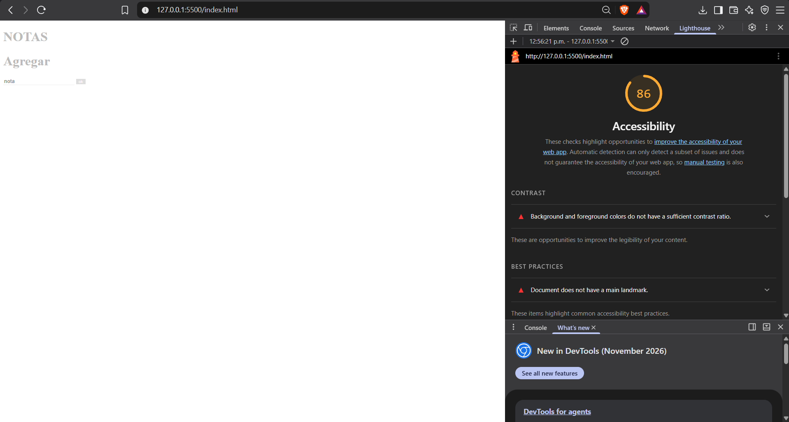
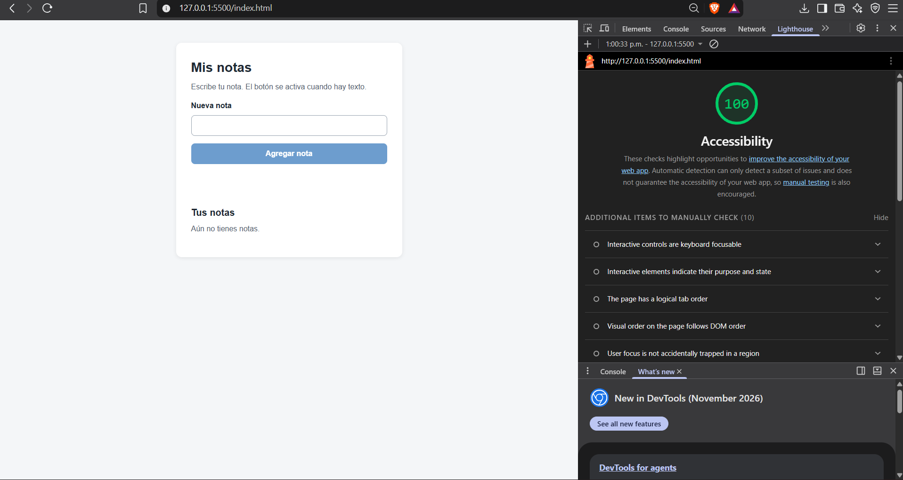

# Auditoría UX de app-notas

## 1. Tabla de heurísticas

| Heurística | Problema original | Solución aplicada |
|---|---|---|
| Visibilidad del estado | Al agregar o borrar una nota no aparece ningún mensaje. | Mensaje visible después de cada acción: «Nota agregada», «Nota eliminada». |
| Coincidencia con el mundo real | El botón decía «ok» y el borrado era un enlace «BORRAR». | Botones con verbos claros: «Agregar nota» y «Eliminar». |
| Control y libertad | Borrar eliminaba la nota al instante y no se podía recuperar. | Botón «Deshacer» en el mensaje que aparece tras eliminar. |
| Prevención de errores | Se podían agregar notas vacías. | El botón «Agregar nota» está desactivado mientras el campo esté vacío. |
| Reconocer, no recordar | El campo solo tenía un placeholder «nota» que desaparecía al escribir. | `<label>` visible «Nueva nota» encima del campo. |

## 2. Leyes de usabilidad

- **Ley de Fitts:** el botón «Agregar nota» ocupa todo el ancho y mide 44px de alto, y los botones «Eliminar» también miden 44px. Son objetivos grandes, fáciles de acertar con mouse o con el dedo.
- **Ley de Hick:** la pantalla tiene una sola decisión principal (escribir y agregar). Quité el segundo título y los elementos innecesarios para que la persona no dude entre varias opciones.
- **Ley de Miller:** la pantalla se divide en dos bloques cortos, «Nueva nota» y «Tus notas». Cada nota es una línea corta con una sola acción.

## 3. Accesibilidad y principios visuales

- Un solo `<h1>` (antes había dos); «Tus notas» es un `<h2>`.
- `<label>` en el campo y `aria-label` en cada botón «Eliminar».
- Foco visible naranja con `:focus-visible` (antes `outline: none`).
- Contraste mínimo de 4.5:1 (antes #bbbbbb sobre blanco, menos de 2:1).
- Colores en variables CSS dentro de `:root`; espaciado en múltiplos de 8.
- `role="status"` en el mensaje para que el lector de pantalla lo anuncie.

## 4. Lighthouse (Accesibilidad)

**Antes:** XX / 100

**Después:** XX / 100

